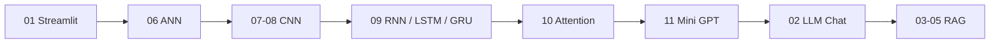
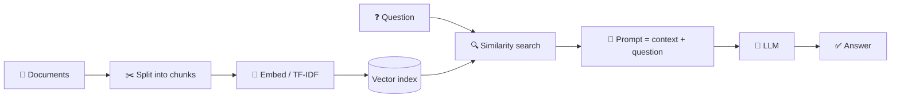

<div align="center">


Deep Learning training programme work, organised from basics to LLMs.

</div>

---

## 🗺️ Learning Path



## 📂 Repository Structure

| # | Folder | Topic | Stack |
|---|---|---|---|
| 01 | [`01_streamlit_basics`](01_streamlit_basics) | Streamlit widgets & layout tutorial | Streamlit |
| 02 | [`02_llm_chat_ollama`](02_llm_chat_ollama) | Simple LLM chat with a prompt template | LangChain · Ollama (gemma2:2b) |
| 03 | [`03_rag_cpp_chatbot`](03_rag_cpp_chatbot) | RAG over C++ notes: retrieval only → RAG + LLM → full chat app | FAISS · MiniLM embeddings · Ollama |
| 04 | [`04_rag_document_assistant`](04_rag_document_assistant) | Upload PDFs/TXTs and chat with them | LangChain · FAISS · pypdf |
| 05 | [`05_rag_college_assistant`](05_rag_college_assistant) | College knowledge assistant with citations, conflict detection & tests | TF-IDF · scikit-learn · pytest |
| 06 | [`06_ann_basics`](06_ann_basics) | Churn classification, ANN regression, K-Fold CV | Keras · scikit-learn |
| 07 | [`07_cnn_keras`](07_cnn_keras) | CNN app (CIFAR-10 / Cats vs Dogs), MNIST, Beans transfer learning | Keras · Streamlit |
| 08 | [`08_cnn_pytorch_vision_studio`](08_cnn_pytorch_vision_studio) | CNN studio with augmentation, Grad-CAM & feature maps | PyTorch · Streamlit |
| 09 | [`09_rnn_lstm_gru`](09_rnn_lstm_gru) | IMDB sentiment: SimpleRNN vs LSTM vs GRU + trained models | Keras |
| 10 | [`10_transformers_attention`](10_transformers_attention) | *Attention Is All You Need* paper + notebook | Keras |
| 11 | [`11_mini_gpt`](11_mini_gpt) | Character-level GPT built from scratch | TensorFlow |

## 🧠 RAG Pipeline (folders 03–05)



## 🤖 Mini GPT (folder 11)

```
11_mini_gpt/
├── config.py     # hyperparameters (shared by train + generate)
├── data.py       # corpus, character tokenizer, train/val datasets
├── model.py      # GPTBlock (masked self-attention + FFN) and MiniGPT
├── train.py      # trains and saves mini_gpt.weights.h5
└── generate.py   # loads weights, samples text with temperature
```

## ⚙️ Setup

```bash
python -m venv venv
venv\Scripts\activate          # Windows  (Linux/Mac: source venv/bin/activate)
pip install -r requirements.txt
```

For the LLM / RAG apps install [Ollama](https://ollama.com) and pull the model:

```bash
ollama pull gemma2:2b
```

## ▶️ Running

Run each project **from inside its folder** (file paths are relative):

| Project | Command |
|---|---|
| Streamlit basics | `cd 01_streamlit_basics && streamlit run streamlit_tutorial.py` |
| LLM chat | `cd 02_llm_chat_ollama && streamlit run chat_app.py` |
| C++ RAG chatbot | `cd 03_rag_cpp_chatbot && streamlit run 3_rag_chat_app.py` |
| Document assistant | `cd 04_rag_document_assistant && streamlit run app.py` |
| College assistant | `cd 05_rag_college_assistant && streamlit run app.py` |
| College assistant tests | `cd 05_rag_college_assistant && pytest test_rag.py -v` |
| CNN (Keras) | `cd 07_cnn_keras && streamlit run app.py` |
| CNN Vision Studio | `cd 08_cnn_pytorch_vision_studio && streamlit run app.py` |
| RNN vs LSTM vs GRU | `cd 09_rnn_lstm_gru && python sentiment_rnn_lstm_gru.py` |
| Mini GPT | `cd 11_mini_gpt && python train.py && python generate.py` |

Notebooks (`.ipynb`) can be opened in Jupyter or Google Colab. The churn and regression notebooks expect their CSV datasets in the same folder.

## 🙏 Credits

This repository brings together work from our DL training batch. Original authors:

| Folder | Source |
|---|---|
| 01, 03 (scripts + `rag_tutorial.ipynb`), 05, 07 (`app.py`, `cnn_model.py`), 10 (notebook) | [Soham-Sahana/RAG](https://github.com/Soham-Sahana/RAG) |
| 06, 07 (notebooks), 09 (`models/`) | [Soham-Sahana/Deep-Learning-Projects](https://github.com/Soham-Sahana/Deep-Learning-Projects) |
| 02, 03 (`cpp_chat.ipynb`), 04, 10 (paper PDF) | [24khank-maker/DL](https://github.com/24khank-maker/DL) |
| 08 | [Sakshamjak1905/DL_Training-_Project_3](https://github.com/Sakshamjak1905/DL_Training-_Project_3) |
| 11 | Training-session `mini_gpt` notebook, split into modules |
| 09 (`sentiment_rnn_lstm_gru.py`), repo structure & README | Written for this repo with AI assistance (Claude) |

<div align="center">

</div>
